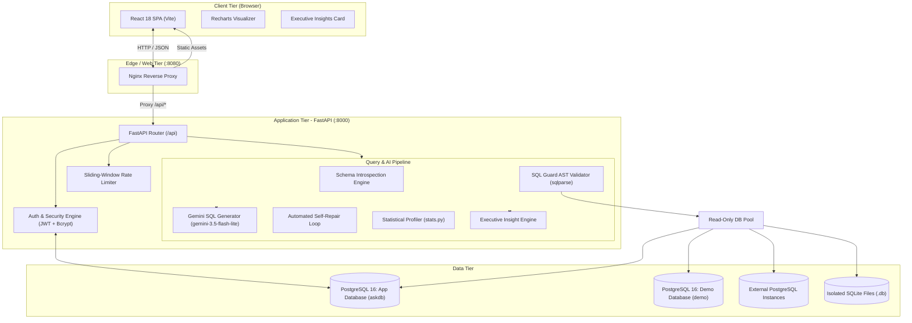
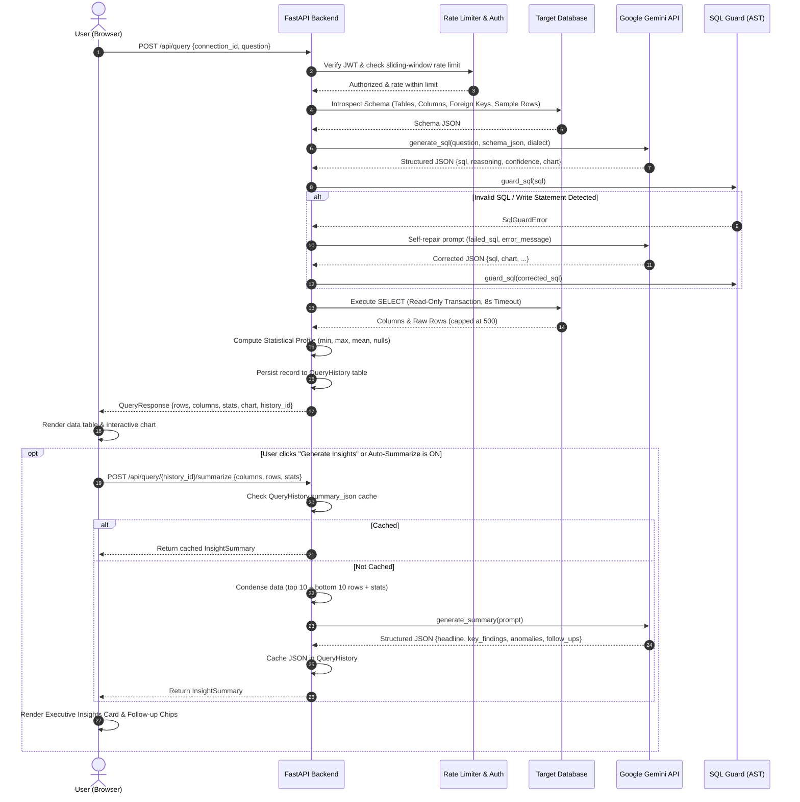

# AskDB: Technical Deep-Dive & Interview Preparation Guide

This document is an exhaustive, production-grade technical breakdown of **AskDB**. It is designed to prepare you for technical interviews, system design discussions, and deep architectural questions.

---

## 1. Executive Summary & Problem Statement

### What is AskDB?
**AskDB** is an enterprise-grade, full-stack Natural Language-to-SQL (Text-to-SQL) exploration engine and analytics studio. It allows users to ask ad-hoc questions against relational databases in plain English, securely compiles those questions into dialect-specific read-only SQL via Google Gemini, executes queries within a strict sandbox, computes column profiling statistics, renders interactive visualizations, and synthesizes structured executive insights.

### The Engineering Challenges Solved
1. **The LLM Security Problem (SQL Injection & Destructive Queries)**: LLMs can hallucinate `DROP`, `DELETE`, or `UPDATE` statements, or be manipulated via prompt injection. AskDB implements defense-in-depth across AST validation, token masking, and database-level transaction locks.
2. **The Hallucinated Schema Problem**: LLMs frequently invent non-existent table joins and columns. AskDB uses dynamic introspection to inject verified schema graphs and data samples into the prompt context.
3. **The Brittle Query Problem**: Dialect mismatches and syntax edge-cases cause raw queries to fail. AskDB features an automated self-repair loop that feeds database errors back to the model for correction.
4. **The Latency vs. Insight Trade-off**: Running LLM summarization synchronously blocks UI rendering. AskDB decouples query execution from executive insight generation via asynchronous endpoints and persistent database caching.

---

## 2. High-Level System Architecture

AskDB is deployed as a containerized micro-architecture managed via Docker Compose.



---

## 3. Detailed Component Breakdown: What We Used & Why

| Stage / Component | Technology Used | Why This Choice? (Interview Justification) |
| :--- | :--- | :--- |
| **Frontend Framework** | **React 18 + Vite** | Instant HMR development speed, small bundle footprint, declarative UI state for switching between Table, Chart, SQL, Reasoning, and Stats. |
| **Data Visualization** | **Recharts (D3 Wrapper)** | Declarative, SVG-based responsive rendering with built-in chart transitions. Supports Bar, Line, Area, Scatter, Histogram, and Pie charts out-of-the-box. |
| **API Framework** | **FastAPI (Python 3.12)** | Native async event loop, high throughput, automatic OpenAPI documentation, and strict runtime type validation via Pydantic v2. |
| **LLM Model** | **Gemini 3.5 Flash-Lite / 3.8 Flash** | Industry-leading cost-to-performance ratio on the free tier, sub-1.5s latency, high token output limit, and native JSON Schema output support (`responseSchema`). |
| **SQL Parser / Guard** | **`sqlparse` + Regex AST Inspection** | Deterministic token-tree analysis. Unlike regex-only approaches that fail on comments (`/* ... */`) or nested queries, `sqlparse` accurately strips comments and isolates individual statements. |
| **Database Driver** | **SQLAlchemy 2.0 + Psycopg3** | Modern connection pooling (`NullPool` for SQLite, fixed pools for Postgres), multi-dialect reflection (`inspect()`), and standard DBAPI hooks. |
| **Secret Encryption** | **Cryptography (Fernet / AES-128-CBC)** | Encrypts external user database passwords before saving to disk. Derived via PBKDF2 HMAC-SHA256 from `JWT_SECRET`. Plaintext credentials never touch disk. |
| **Reverse Proxy** | **Nginx (Alpine)** | Single entry point (`:8080`) routing both static assets and `/api` requests. Eliminates Cross-Origin Resource Sharing (CORS) complications in production. |

---

## 4. End-to-End Query & Insights Workflow

### Sequence Diagram: The Full Lifecycle of a Question



---

## 5. Security & Defense-in-Depth Architecture

In an interview, **security** around Text-to-SQL is the #1 area interviewers will grill you on. AskDB implements **five distinct layers of defense**:

### Layer 1: AST Statement Validation (`sql_guard.py`)
* **Single Statement Enforcement**: Uses `sqlparse.parse()` to strip comments and verify that exactly one SQL statement is present. Rejects stacked query attempts (e.g., `SELECT 1; DROP TABLE users;`).
* **Leading Keyword Restriction**: Checks that the masked statement strictly starts with `SELECT` or `WITH`.
* **Prohibited Token Blacklist**: Evaluates tokens against a regex blacklist covering:
  * DDL/DML: `insert`, `update`, `delete`, `drop`, `alter`, `create`, `truncate`, `merge`, `into`.
  * Administrative/Execution: `grant`, `revoke`, `copy`, `execute`, `exec`, `call`, `vacuum`, `reindex`.
  * File System & OS Probes: `pg_read_file`, `pg_read_binary_file`, `pg_ls_dir`, `pg_stat_file`, `lo_import`, `lo_export`, `dblink`.
  * Denial of Service: `pg_sleep`, `pg_terminate_backend`, `pg_cancel_backend`.
  * SQLite Specifics: `attach`, `detach`, `pragma`.
* **Deterministic Row Capping**: Detects trailing `LIMIT` clauses. If absent, appends `LIMIT 500`. If present but greater than 500, rewrites it to `LIMIT 500`.

### Layer 2: Database Connection Sandboxing (`database.py`)
Even if a malicious query bypassed the AST validator, the database driver blocks it at the wire protocol level:
* **PostgreSQL Session Hooks**: On connection, SQLAlchemy fires event listeners executing:
  ```sql
  SET default_transaction_read_only = on;
  SET statement_timeout = '8s';
  ```
* **SQLite Session Hooks**: Every connection enforces:
  ```sql
  PRAGMA query_only = ON;
  ```
* **Demo Database Role**: The pre-seeded demo runs under the unprivileged role `demo_reader`, which only possesses `GRANT SELECT` privileges.

### Layer 3: Network & SSRF Guardrails (`database.py`)
When users configure custom Postgres connections, the backend validates the `host` parameter:
* Rejects URLs, scheme prefixes (`http://`, `postgres://`), and path traversal characters.
* Explicitly blocks cloud metadata IP addresses (`169.254.169.254`, `metadata.google.internal`) to prevent cloud instance credential theft via SSRF.

### Layer 4: Credential Encryption & Session Security (`security.py`, `crypto.py`)
* Passwords hashed using `bcrypt` with work factor 12. Includes a constant-time `dummy_password_hash()` check during login to defeat user enumeration timing attacks.
* External database passwords saved in `SavedConnection` are encrypted using **Fernet (AES-128 in CBC mode with HMAC-SHA256)**. The encryption key is derived dynamically using PBKDF2 with 100,000 iterations over `JWT_SECRET`.
* Sessions use short-lived JWT access tokens (30 mins) with SHA-256 hashed refresh tokens stored in the database with revocation tracking.

### Layer 5: Rate Limiting & Quota Guards (`limiter.py`, `query.py`)
* In-memory sliding-window rate limiting using `collections.deque` protected by thread locks (`threading.Lock`).
* Per-user and per-IP throttling on login (8/min), registration (5/min), and queries (8/min).
* Persistent daily limit enforced in PostgreSQL (capped at 40 AI queries per 24-hour UTC window) to prevent exhaustion of free-tier Gemini API quotas.

---

## 6. The AI Engineering Pipeline

### A. Dynamic Context Injection
Instead of sending an entire database schema (which can exhaust context windows or confuse models), AskDB serializes:
* Dialect identifier (`postgresql` or `sqlite`).
* Up to 30 tables with column names, primary key flags, and foreign key relations.
* 2 JSON-safe sample rows per table to ground the model in actual formatting (e.g., date formats, status strings like `'paid'` vs `'completed'`).
* Domain knowledge notes (e.g., `"Harbor & Co. revenue is order_items.quantity * order_items.unit_price"`).

### B. Structured Outputs via Gemini JSON Schema
Rather than parsing raw markdown backticks, AskDB configures Gemini's `responseSchema` and `responseMimeType: "application/json"`:
```python
_RESPONSE_SCHEMA = {
    "type": "OBJECT",
    "properties": {
        "sql": {"type": "STRING"},
        "reasoning": {"type": "STRING"},
        "confidence": {"type": "NUMBER"},
        "tables_used": {"type": "ARRAY", "items": {"type": "STRING"}},
        "chart": {"type": "STRING"},
        "x_column": {"type": "STRING"},
        "y_column": {"type": "STRING"},
        "error": {"type": "STRING"},
    },
    "required": ["sql", "reasoning", "confidence", "tables_used", "chart"],
}
```

### C. Automated Self-Healing Query Repair
If a query fails execution (e.g. Postgres returns `column "rev" does not exist`), AskDB invokes an automatic second-chance repair:
```python
plan = generate_sql(
    question, schema, dialect, note,
    previous_sql=plan["sql"],
    previous_error=str(first_error)
)
```
The user never sees the intermediate failure if the repaired query succeeds.

### D. Smart Data Condensation for Executive Insights
To generate high-level business takeaways without blowing token budgets:
1. AskDB runs statistical profiling on the result set (`stats.py`), calculating row count, null count, distinct count, min, max, and mean.
2. It slices the top 10 and bottom 10 rows (`condense_rows()`).
3. It passes both the statistics and the condensed rows to the summary model.
4. Gemini returns a structured JSON payload:
   * **Headline**: High-level punchline.
   * **Key Findings**: 3-4 bullet points highlighting proportions, rankings, or totals.
   * **Anomalies**: Outlier callouts (zeros, sudden spikes, missing data).
   * **Follow-up Questions**: 3-4 clickable prompts for deeper data exploration.

---

## 7. Complete Catalog of Important Files

### Root & Infrastructure
* `docker-compose.yml`: Multi-container orchestration defining `db` (Postgres 16), `api` (FastAPI), and `web` (Nginx + React SPA), including health check dependencies and named volumes (`pgdata`, `uploads`).
* `.env.example`: Environment variable blueprint defining `GEMINI_API_KEY`, `GEMINI_MODEL`, `JWT_SECRET`, database connection strings, and rate limit quotas.

### Backend Application (`backend/app/`)
* `main.py`: Application entry point. Configures CORS, sets up `lifespan` context (with a 60-second database connectivity polling loop and auto-migration), registers routers, and exposes `/api/health`.
* `config.py`: Pydantic `BaseSettings` reading environment variables for tokens, database URLs, Gemini keys, and rate limits.
* `models.py`: SQLAlchemy 2.0 ORM models:
  * `User`: Application accounts (id, name, email, bcrypt hash).
  * `RefreshToken`: Refresh tokens with SHA-256 token hashes, expiry dates, and revocation flags.
  * `SavedConnection`: Connection configurations (Postgres credentials encrypted via Fernet, or SQLite file paths).
  * `QueryHistory`: Audit log of queries, SQL text, reasoning, chart types, execution times, success flags, and cached `summary_json`.
* `schemas.py`: Pydantic models for request validation and response serialization (`AskRequest`, `RunSqlRequest`, `QueryResponse`, `InsightSummary`, `SummarizeRequest`, `HistoryItem`, `ConnectionPublic`).
* `security.py`: Security primitives. Bcrypt password hashing, constant-time dummy verification, HS256 JWT access token issuance/decoding, and cryptographically secure refresh token generators.
* `crypto.py`: Fernet AES symmetric encryption routines for database passwords using PBKDF2 key derivation.
* `limiter.py`: Thread-safe in-memory sliding-window rate limiter implemented with `collections.deque` and locks.
* `deps.py`: FastAPI dependency injection for extracting and validating the current authenticated user from Bearer tokens.
* `db.py`: SQLAlchemy database engine initialization, `sessionmaker`, and request session lifecycle generator `get_db()`.

### Backend Services (`backend/app/services/`)
* `gemini.py`: LLM integration engine. Prompt builders for Text-to-SQL and Executive Summaries, JSON Schema definitions, HTTP client calls to Google Generative Language API, error parsing, and row condensation.
* `sql_guard.py`: Deterministic SQL validator. Strips comments, parses single-statement ASTs with `sqlparse`, blocks prohibited keywords and administrative functions via regex, and enforces row capping.
* `database.py`: Target database manager. Dynamic introspection of schema and foreign keys, engine connection pooling, read-only transaction listener configuration, ping connectivity checks, and SSRF host validation.
* `stats.py`: Result set statistical profiler. Infers column kinds (`number`, `date`, `boolean`, `text`) and calculates metrics (nulls, distinct values, min, max, mean, top category).
* `query.py`: Query execution coordinator. Connects schema introspection, Gemini SQL generation, self-repair loops, SQL guard validation, database execution, statistics profiling, and history persistence.

### Backend Routers (`backend/app/routers/`)
* `auth.py`: User registration, password verification, token issuance, token rotation, and logout endpoints.
* `connections.py`: Database management endpoints (listing connections, adding Postgres credentials, uploading SQLite files up to 20MB, fetching introspected schemas, deleting connections).
* `query.py`: Query endpoints: `/api/query` (natural language prompt), `/api/query/run` (manual raw SQL), `/api/query/{id}/summarize` (asynchronous insights), and history management.

### Backend SQL & Tests
* `backend/sql/init.sql`: PostgreSQL startup script. Seeds the Harbor & Co. retail dataset (`regions`, `stores`, `employees`, `customers`, `categories`, `products`, `orders`, `order_items`) and creates the read-only `demo_reader` role.
* `backend/tests/test_sql_guard.py`: Unit tests verifying SQL Guard behavior across comments, destructive statements, injection attempts, and LIMIT rewriting.
* `backend/tests/test_security.py`: Unit tests verifying bcrypt hashing, JWT issuance/validation, password strength rules, and Fernet encryption/decryption.
* `backend/tests/test_summary.py`: Unit tests verifying row condensation, prompt assembly, and fallback JSON normalization for AI insights.

### Frontend Application (`frontend/src/`)
* `main.jsx`: React root mounting `BrowserRouter` and `AuthProvider`.
* `App.jsx`: Routing definition with authentication guards (`RequireAuth` and `GuestOnly`).
* `api.js`: Central fetch utility that attaches Bearer tokens, handles token expiration errors, and serializes JSON.
* `auth.jsx`: React Context provider managing user state, login, logout, and automatic silent token refresh on app boot.
* `pages/Studio.jsx`: The core workspace interface. Includes:
  * Schema Explorer sidebar with interactive column tokens.
  * Query input with suggested questions.
  * Result meta banner (elapsed ms, row count, confidence, correction badge).
  * Executive Insights Card with animated pulse loader, key findings, anomaly callouts, and clickable follow-up chips.
  * Tabbed results switcher (Table with sorting, Chart, SQL, Reasoning, Stats).
  * Manual SQL runner and CSV/JSON data export buttons.
  * History drawer with status indicators.
* `components/ChartView.jsx`: Visual analytics engine built on Recharts. Dynamically switches between Bar, Line, Area, Scatter, Histogram, and Pie charts with automated X/Y axis column alignment.
* `components/ConnectModal.jsx`: Modal for adding custom Postgres connections (with immediate ping verification) and uploading local SQLite databases.
* `styles.css`: Complete custom styling system (editorial aesthetic, responsive grid/canvas, typography, and insight card animations).
* `nginx.conf`: Nginx configuration for serving the React production bundle, fallback routing for SPAs (`try_files`), and reverse proxying `/api` to the backend container.

---

## 8. Common Interview Questions & Model Answers

### Q1: "How do you prevent SQL injection or malicious database writes from an LLM?"
> **Answer**:  
> "We implement defense-in-depth across three separate layers:  
> 1. **AST Validation (`sql_guard.py`)**: Before hitting the database, the query is parsed using `sqlparse`. We strip all comments, verify that exactly one statement is present (preventing query stacking), ensure it starts strictly with `SELECT` or `WITH`, and run token inspection against a blacklist of forbidden keywords (`INSERT`, `UPDATE`, `DROP`, `pg_read_file`, `dblink`, etc.). We also enforce a hard `LIMIT 500`.  
> 2. **Database Engine Session Locks**: Even if a query bypasses the AST parser, SQLAlchemy connection listeners enforce `SET default_transaction_read_only = on` and a strict 8-second statement timeout on Postgres, and `PRAGMA query_only = ON` on SQLite.  
> 3. **Database Role Privileges**: The default demo dataset connects through an isolated role (`demo_reader`) that only possesses `GRANT SELECT` privileges."

### Q2: "Why did you separate the Executive Insights summarization from the main query endpoint?"
> **Answer**:  
> "Query execution latency is critical for user experience. Generating the SQL, running the query, and calculating statistics takes ~800ms–1.5s. If we had synchronously chained a second LLM summarization call into the same endpoint, response times would have jumped to 3–4 seconds before the user could see any data.  
> By decoupling summarization into an asynchronous endpoint (`/api/query/{id}/summarize`), the table and charts render immediately. The user can either trigger insights on-demand or enable auto-summarization, which streams or loads into the UI without blocking interaction. Furthermore, caching the summary in `QueryHistory.summary_json` ensures that revisiting past queries doesn't consume extra LLM quota."

### Q3: "How does AskDB handle LLM hallucinations where Gemini uses wrong column or table names?"
> **Answer**:  
> "First, we prevent hallucinations proactively by injecting the introspected schema graph—including data types, foreign keys, and two actual sample rows per table—into the prompt context. This grounds the model in real schema identifiers.  
> Second, if the model still produces an invalid query (for instance, referencing a nonexistent column or making an invalid join), our backend captures the exact database error and triggers an automated self-repair loop (`answer_question`). It sends the failed SQL along with the exact database error back to Gemini to generate a corrected query before returning a response to the user."

### Q4: "How do you handle large datasets when summarizing without hitting LLM context limits?"
> **Answer**:  
> "Instead of dumping all 500 rows into the prompt context (which would increase latency and token costs), we use a smart condensation technique. Our `stats.py` engine computes aggregate profiles (min, max, mean, null counts, distinct counts) for every column. We then combine these statistics with the top 10 and bottom 10 rows via `condense_rows()`. This gives the LLM full visibility into distributions, extremes, and real labels while keeping token consumption below 1,000 tokens."

### Q5: "How are external database passwords protected?"
> **Answer**:  
> "We never store raw database credentials in plaintext. When a user connects their own PostgreSQL instance, the password is encrypted using Fernet (symmetric AES-128 in CBC mode with an HMAC-SHA256 signature). The encryption key is derived using PBKDF2 with 100,000 iterations over the server's `JWT_SECRET`. The encrypted cipher is stored in PostgreSQL and only decrypted in-memory when establishing a database connection pool."
